<picture>
  <source media="(prefers-color-scheme: dark)" srcset="./dark.svg">
  <source media="(prefers-color-scheme: light)" srcset="./light.svg">
  
</picture>

## Hi, I'm Sami Hasan (Hojaifa)

I'm a **Web Developer** who builds for the web with modern tools like React, Next.js, Tailwind CSS and Node.js.

## About Me

I work with modern web technologies, from the foundations of HTML, CSS and JavaScript to React and Next.js on the front end and Node.js on the back end. This profile is where my projects and work will be collected as I add them.

## Technologies and Tools

  
  
  
  
  
  
  

## Featured Projects

Featured projects will appear here soon. When a project is ready, add it to the table below.

| Project | Description | Stack | Links |
| :-- | :-- | :-- | :-- |
| _Coming soon_ | _Project details will be added here._ | — | — |

<!--
HOW TO ADD A PROJECT
Replace the "Coming soon" row above with a real row like this:

| [Project Name](https://github.com/mdhojaifa2004-collab/REPO-NAME) | One-line description. | React, Tailwind CSS | [Live](https://your-live-link) |
-->

## GitHub Activity

  
  

These widgets come from an external service and may load slowly or be unavailable at times. They fill in as you add public repositories and activity.

## Connect With Me

  
  

- GitHub: https://github.com/mdhojaifa2004-collab
- LinkedIn: https://www.linkedin.com/in/sami-hasan-hojaifa-020360367/

---

Thanks for stopping by. Feel free to look around and get in touch.

